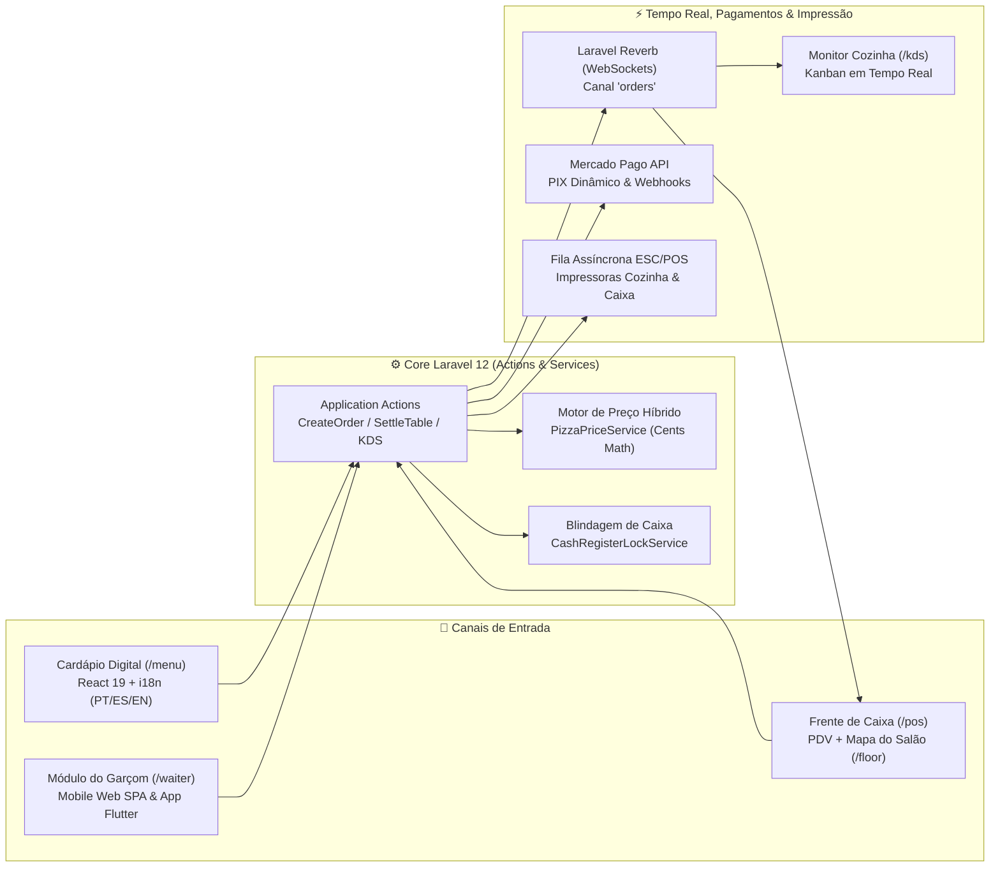

# 🚀 Pedido Feito 2.0 — Documentação Oficial de Produto, Arquitetura e Estratégia de Landing Page SaaS

> **Produto:** Pedido Feito 2.0 — Sistema de Gestão e Operação de Alta Performance para Pizzarias e Restaurantes  
> **Desenvolvedora:** Pixirica Tecnologias (Fundador: João Gabriel)  
> **Objetivo do Documento:**  
> 1. **Engenharia & Produto:** Documentação oficial completa da arquitetura, regras de negócio, módulos e fluxos reais implementados no código-fonte.  
> 2. **Marketing, Branding (Pomelli) & Growth SaaS:** Base estratégica de posicionamento, argumentos comerciais de vendas e copywriting de alta conversão para a Landing Page oficial.

---

## 1. Visão Geral e Proposta de Valor

### 1.1 Resumo Executivo: O que o Pedido Feito 2.0 resolve hoje na prática?

A maior dor do mercado de softwares gastronômicos é que a maioria dos sistemas é projetada por desenvolvedores que nunca vivenciaram o caos de um salão lotado em uma sexta-feira à noite. O resultado são telas poluídas, dezenas de cliques para lançar uma pizza meio-a-meio, erros de cálculo em bordas/frações, comandas de papel que somem na cozinha e fechamentos de caixa cheios de furos financeiros ("quebras de caixa" e "pedidos fantasmas").

O **Pedido Feito 2.0**, concebido pela **Pixirica Tecnologias** a partir de **13 anos de experiência real em operação de pizzarias de alto fluxo**, resolve a operação de ponta a ponta em uma plataforma unificada, em tempo real e à prova de falhas humanas:

1. **Velocidade Extrema no Atendimento (Zero Papel):** O garçom lança pedidos complexos (pizzas com múltiplos sabores, bordas recheadas e exclusão de ingredientes por metade) diretamente pelo celular em poucos toques. O pedido salta instantaneamente na tela da cozinha (KDS) via WebSockets e dispara a impressão térmica setorizada sem intervenção humana.
2. **Precificação Híbrida Automatizada:** Elimina contas de cabeça e erros de cobrança. O motor de cálculo nativo resolve automaticamente a regra do sabor mais caro nas pizzas grandes, a regra especial proporcional nas pizzas broto, adicionais de borda e variações de porções/bebidas.
3. **Blindagem Financeira ("Caixa à Prova de Desculpas"):** O sistema impede a criação de pedidos sem um caixa aberto e **bloqueia matematicamente o fechamento do turno** caso exista qualquer comanda ou mesa aberta sem pagamento conciliado. Além disso, descontos no fechamento de mesa exigem validação criptográfica de PIN de um Supervisor/Admin.
4. **Autoatendimento e Cardápio Digital Trilíngue com Pagamento Online:** Clientes na mesa ou no delivery acessam um cardápio digital interativo em **Português, Inglês ou Espanhol**, montam sua própria pizza e pagam via **PIX Dinâmico (QR Code em tempo real)** ou **Cartão de Crédito** integrados ao **Mercado Pago**, com conciliação automática via Webhook.
5. **Visão Gerencial de Lucro Real (DRE Simplificada):** Ao cruzar automaticamente a Receita Bruta dos pedidos pagos com o módulo de Despesas Operacionais (`Expenses`), o dono do restaurante enxerga não apenas quanto vendeu, mas seu **Lucro Líquido** e sua **Margem de Lucro (%)** reais dos últimos 30 dias.

---

### 1.2 Perfis de Acesso e Permissões Identificados no Código (RBAC + Policies)

O controle de acesso do sistema é governado no backend pelo middleware `App\Http\Middleware\EnsureUserHasRole` (com normalização semântica de cargos em português/inglês), pelas policies `OrderPolicy` e `TablePolicy`, e pelo validador de PIN criptografado (`pin_hash` em `users`).

| Perfil de Acesso | Identificadores no Código (`users.role`) | Interfaces de Acesso | O que pode fazer na prática (Escopo de Permissões) |
| :--- | :--- | :--- | :--- |
| **Administrador / Dono (Admin)** | `admin` | Painel Web Completo (`/dashboard`, `/pos`, `/floor`, `/kds`, `/cash-register`, `/reports`, `/expenses`, `/products`, `/flavors`, `/sizes`, `/neighborhoods`, `/users`, `/settings`) + API Sanctum | **Acesso Total:** Gerencia cardápio (produtos, sabores, tamanhos, bairros), cria/edita/exclui mesas no Mapa do Salão (`POST/PUT/DELETE /floor`), cadastra e desliga funcionários (`/users`), lança despesas (`/expenses`), exporta relatórios CSV (`/reports/export`), configura impressoras térmicas e tokens de integração (`/settings`), abre/fecha o caixa e autoriza descontos via PIN. |
| **Supervisor de Turno** | `supervisor` (ou `admin` com `pin_hash` configurado) | Validação Transacional via Modal (`POST /floor/validate-supervisor-pin`) | Autoriza a aplicação de descontos financeiros (em `R$` ou `%`) durante o fechamento de contas de mesas no Mapa do Salão ou App do Garçom, registrando seu `user_id` em `orders.discount_approved_by` para auditoria. |
| **Operador de Caixa (Cashier)** | `caixa` / `cashier` | Painel Operacional (`/dashboard`, `/pos`, `/orders`, `/kds`, `/floor`, `/cash-register`, `/reports`, `/expenses`, cadastros operacionais) | Opera a Frente de Caixa (`/pos`), abre e fecha o turno de caixa (`/cash-register`), gerencia o Mapa do Salão (`/floor`), realiza cobrança com divisão de pagamentos (*split payment*), gera QR Code PIX na mesa e acompanha pedidos. **Restrições:** Não pode gerenciar contas de usuários (`/users` é restrito a `admin`) nem alterar a estrutura física de mesas. |
| **Garçom (Waiter)** | `garcom` / `waiter` | App Web Mobile-First (`/waiter`, `/waiter/orders`, `/waiter/profile`), Mapa do Salão (`/floor`), KDS (`/kds`) e App Nativo Flutter (`waiter_app` via `/api/*`) | Visualiza mesas livres e ocupadas em tempo real, abre mesas, adiciona pizzas personalizadas e produtos (`/floor/{table}/add-items`), acompanha o preparo das comandas (`/waiter/orders`), imprime pré-conta/conferência e realiza o fechamento e recebimento de mesas (`TablePolicy@payAndClose`), inclusive gerando PIX dinâmico na mesa. **Restrições:** Bloqueado no acesso ao caixa geral, relatórios financeiros, configurações e fechamento de mesa sem pagamento (`TablePolicy@closeWithoutPayment`). |
| **Cozinha / Pizzaiolo (KDS)** | Acesso via `admin`, `caixa` ou `garcom` dedicado ao monitor de produção | Monitor KDS (`/kds`) | Visualiza a fila de produção em tempo real dividida em 3 colunas Kanban (*Pendentes*, *Em Preparo*, *Prontos para Servir*), consulta detalhes de modificações/exclusões de ingredientes, avança o status dos pedidos (`POST /kds/{order}/status/{status}`) e reimprime comandas de produção. |
| **Cliente Final (Consumidor)** | Público (identificado por sessão/cookie `customer_phone` e cadastro automático em `customers`) | Cardápio Digital & Autoatendimento (`/menu`, `/menu/cart`, `/menu/checkout`, `/menu/orders`, `/menu/store-profile`, `/menu/order/{order}/status`) | Escolhe o idioma (`pt-BR`, `es-ES`, `en-US`), visualiza stories e perfil da loja, navega pelo catálogo com busca e tradução automática de ingredientes, monta pizzas personalizadas, escolhe modalidade (*Delivery*, *Retirada* ou *Consumo na Mesa*), paga online via PIX ou Cartão (Mercado Pago) e acompanha o status do pedido em tempo real. |

---

## 2. Mapeamento Completo de Módulos Atuais (Features Prontas - MVP)

### 2.1 Frente de Caixa (PDV)

* **Arquivos-Chave:** `app/Http/Controllers/PosController.php`, `resources/js/Pages/POS/Index.jsx`, `resources/js/Pages/POS/PaymentModal.jsx`, `resources/js/Pages/POS/ProductVariationModal.jsx`.
* **(a) Como funciona tecnicamente:**
  * Renderizado como uma SPA via Inertia.js (`POS/Index.jsx`), o controller carrega em memória os produtos ativos para PDV (`is_active_pos = true`), sabores de pizza ativos, tamanhos (`PizzaSize`), opções de bordas (`category = 'Extras'`) e o estado atual do caixa aberto (`CashRegister`).
  * A busca utiliza normalização de strings sem acentos (`norm()` em `resources/js/utils/normalize.js`), filtrando instantaneamente no cliente sem round-trips ao servidor.
  * Produtos com variações (armazenadas em JSON na coluna `products.variations`, como porções P/M/G ou latas/garrafas) acionam automaticamente o `ProductVariationModal.jsx`.
  * No envio (`POST /pos/order`), o `PosController@store` exige um caixa aberto via `CashRegisterLockService`, recalcula todos os preços no servidor (prevenindo manipulação de payload no frontend), cria ou atualiza automaticamente o registro do cliente na tabela `customers` a partir do telefone (`Customer::firstOrCreate`), persiste o pedido e os múltiplos pagamentos (`Payment`) em uma transação atômica (`DB::beginTransaction()`) e dispara o evento WebSocket `OrderCreated` para o KDS.
* **(b) Quais ações o usuário realiza na tela:**
  * Visualiza no topo o status do caixa (Saldo Inicial, Vendas do Turno e Total na Gaveta).
  * Filtra itens por abas de categorias (*Todos*, *Pizzas*, *Bebidas*, etc.) ou digita na barra de busca rápida.
  * Clica em produtos simples para adição imediata (1 clique), seleciona variações quando aplicável ou abre o montador de pizzas.
  * Expande itens no carrinho lateral para conferir observações e alertas vermelhos de restrição alimentar, ajusta quantidades (`+` / `-`) e clica em **"Finalizar Venda"**.
  * No modal de pagamento, informa nome/telefone do cliente (com autocompletar via `/api/customers/search`), combina múltiplas formas de pagamento (*Dinheiro*, *PIX*, *Cartão de Crédito*, *Cartão de Débito*), visualiza o cálculo automático de troco e confirma a venda.
* **(c) Benefício Comercial (Argumento de Vendas):**
  * **Fila Zero no Balcão e no Telefone:** Um operador treinado em 10 minutos consegue fechar um pedido completo em menos de 15 segundos. Além disso, o cadastro automático de clientes por telefone constrói a base de CRM do restaurante de forma invisível, sem atrasar o atendimento.

---

### 2.2 Motor de Pizzas e Personalização

* **Arquivos-Chave:** `app/Services/PizzaPriceService.php`, `app/Application/Pricing/HybridPizzaPricingService.php`, `resources/js/Pages/POS/PizzaBuilderModal.jsx`, `resources/js/Pages/CustomerMenu/components/menu/PizzaBuilderModal.jsx`.
* **(a) Como funciona tecnicamente:**
  * O motor de precificação (`PizzaPriceService` e `HybridPizzaPricingService`) opera com base nos parâmetros do modelo `PizzaSize` (`slices`, `max_flavors`, `is_special_broto_rule`) e `PizzaFlavor` (`base_price`, `ingredients_json`, `flavor_category`).
  * **Fórmula de Cálculo Híbrido:**
    * **Regra Grande / Padrão (`is_special_broto_rule = false`):** Prevalece o maior valor entre os sabores selecionados: $\text{Preço Base} = \max(\text{base\_price dos sabores})$.
    * **Regra Especial Broto (`is_special_broto_rule = true`):** Calcula metade do valor do sabor mais caro acrescido de uma taxa operacional fixa de R$ 5,00: $\text{Preço Base} = \left(\frac{\max(\text{base\_price})}{2}\right) + 5,00$.
    * **Adicional de Borda:** Soma o preço do produto de borda selecionado (ex: Catupiry, Cheddar, Chocolate c/ Avelã) quando o tamanho permite borda.
  * **Personalização Granular de Ingredientes por Fração:** O `PizzaBuilderModal.jsx` lê o array estruturado `ingredients_json` de cada sabor (com fallback inteligente por regex na string `ingredients`) e permite desmarcar ingredientes individualmente em cada metade ou terço da pizza, gerando instruções padronizadas separadas por pipe (`⚠️ Calabresa: Sem Cebola | ⚠️ Portuguesa: Sem Ovo`) e salvando as frações exatas (`1/1`, `1/2`, `1/3`) na tabela pivô `order_item_flavors`.
* **(b) Quais ações o usuário realiza na tela:**
  * Segue um wizard intuitivo de 3 passos:
    1. **Passo 1 (Tamanho):** Escolhe o tamanho (ex: *Broto - 6 fatias / 1 sabor* ou *Grande - 12 fatias / até 3 sabores*).
    2. **Passo 2 (Sabores e Ingredientes):** Busca e seleciona os sabores; ao tocar em um sabor, um sub-modal exibe todos os ingredientes daquela receita em botões clicáveis para retirar itens indesejados (ex: *"Sem Cebola"*).
    3. **Passo 3 (Borda e Observações):** Escolhe a borda recheada (ou sem borda), adiciona observações livres e acompanha o preço final atualizado em tempo real no rodapé antes de confirmar.
* **(c) Benefício Comercial (Argumento de Vendas):**
  * **Proteção de Margem (CMV) e Fim das Pizzas Erradas:** O dono da pizzaria nunca mais perde dinheiro cobrando preço médio em pizzas com sabores nobres (camarão, filé, burrata), e a cozinha recebe exatamente de qual metade deve retirar cada ingrediente, reduzindo a zero o desperdício de insumos com pizzas devolvidas.

---

### 2.3 Módulo do Garçom (Mobile/Tablet)

* **Arquivos-Chave:** `app/Http/Controllers/WaiterController.php`, `app/Http/Controllers/Api/OrderController.php`, `resources/js/Layouts/MobileLayout.jsx`, `resources/js/Pages/Waiter/Index.jsx`, `resources/js/Pages/Waiter/Orders.jsx`, `resources/js/Pages/Waiter/Profile.jsx`, `resources/js/Pages/Floor/TableOrderDrawer.jsx`, `waiter_app/lib/main_waiter.dart`.
* **(a) Como funciona tecnicamente:**
  * Possui arquitetura dupla: uma **Web App Mobile-First em React 19 + Inertia.js** (`/waiter`) com layout dedicado (`MobileLayout.jsx` em `100dvh`, safe-area para iOS/Android e header retrátil com histerese de scroll) e um **App Nativo Flutter/Dart 3** (`waiter_app`) que consome a API REST autenticada via Laravel Sanctum (`/api/sync`, `/api/orders`, `/api/tables/{table}/pay`).
  * Quando o garçom adiciona itens a uma mesa (`POST /floor/{table}/add-items` ou `POST /api/orders`), o sistema cria um novo pedido vinculado à mesa (`type = 'dine_in'` / `'salon'`) para evitar o bug de "pedido infinito" na cozinha, atualiza o status da mesa para `occupied` e transmite o evento em tempo real para o KDS e para todos os terminais do salão.
* **(b) Quais ações o usuário realiza na tela:**
  * Acessa pelo smartphone na aba **Mesas**, onde vê o resumo rápido (*Total*, *Livres* em verde pulsante, *Ocupadas* em laranja com valor da conta e tempo de permanência em minutos).
  * Toca em uma mesa para abrir o `TableOrderDrawer` em tela cheia:
    * Na visão **Adicionar Itens**, busca produtos, filtra categorias, monta pizzas personalizadas e adiciona observações rápidas.
    * Na visão **Carrinho / Conta Atual**, confere todos os pedidos já lançados na mesa, imprime a conferência de conta (`ReceiptPrint.jsx`) e dispara novos itens direto para a cozinha.
    * No **Fechamento da Mesa**, aciona o `CheckoutModal` direto pelo celular: ativa/desativa a taxa de serviço de 10% (`ServiceFeeToggle`), usa a calculadora de divisão por pessoa (`CalculatorPopover`), solicita desconto mediante senha PIN do gerente (`SupervisorPinModal`), gera um **QR Code PIX Dinâmico** na tela do celular para o cliente escanear na mesa (com cronômetro regressivo e confirmação automática a cada 5s) ou registra pagamento em dinheiro/cartão.
  * Na aba **Comandas** (`/waiter/orders`), acompanha o status de preparo de todos os pedidos ativos no salão.
* **(c) Benefício Comercial (Argumento de Vendas):**
  * **Giro de Mesa 40% Mais Rápido:** O garçom não precisa caminhar até o computador do caixa para lançar pedidos nem para fechar a conta ou gerar um PIX. Ele resolve do pedido ao pagamento na palma da mão ao lado do cliente, aumentando o ticket médio (mais rodadas de bebidas) e liberando mesas muito mais rápido nos horários de pico.

---

### 2.4 Mapa do Salão (Floor Plan)

* **Arquivos-Chave:** `app/Http/Controllers/FloorController.php`, `app/Application/Orders/SettleTableModule.php`, `app/Models/Table.php`, `app/Models/FloorElement.php`, `resources/js/Pages/Floor/Index.jsx`, `resources/js/Pages/Floor/components/Checkout/*`.
* **(a) Como funciona tecnicamente:**
  * O `FloorController@index` agrega todas as mesas (`Table`) com seus pedidos ativos (`activeOrders`), calculando o total consolidado da mesa, o código curto do pedido (`short_code`), o tempo decorrido (`elapsed_minutes`) e o *lead time* de preparo (`diffInMinutes` entre `created_at` e `ready_at`).
  * A tela `Floor/Index.jsx` assina o canal WebSocket `orders` através do hook `useOrderChannel({ only: ['tables', 'stats'] })`. Qualquer pedido lançado por um garçom ou atualizado pela cozinha reflete instantaneamente nos cards de mesa via *partial reload* do Inertia sem recarregar a página.
  * O fechamento financeiro da mesa é processado pelo módulo `SettleTableModule.php`, que aplica `lockForUpdate()` no banco de dados (prevenindo *race conditions* de pagamentos simultâneos), executa toda a matemática em **centavos inteiros (`integer cents`)** e distribui pagamentos parciais/múltiplos em cascata (*waterfall payment distribution*) entre todas as comandas abertas daquela mesa.
* **(b) Quais ações o usuário realiza na tela:**
  * Visualiza os 3 indicadores de ocupação no topo (*Total de Mesas*, *Mesas Livres* e *Mesas Ocupadas*) e busca mesas pelo nome/número.
  * Identifica visualmente o estado de cada mesa por cores semânticas (Verde = Livre; Laranja = Ocupada com cronômetro, nº da comanda e subtotal acumulado).
  * Clica em qualquer mesa para abrir a gaveta lateral (`TableOrderDrawer`), onde pode lançar novos itens, imprimir a pré-conta de conferência (`BillConference.jsx`) ou realizar o checkout completo (com taxa de serviço de 10%, desconto autorizado por PIN de supervisor, divisão de pagamento em múltiplos métodos e PIX dinâmico).
  * Ativa o botão **"Editar Layout"** (exclusivo para Admin) para criar novas mesas, alterar a capacidade de lugares (`seats`/`capacity`) ou excluir mesas.
* **(c) Benefício Comercial (Argumento de Vendas):**
  * **Controle Visual Absoluto do Salão:** O gerente ou operador de caixa bate o olho na tela e sabe exatamente quais mesas estão paradas há muito tempo, quanto dinheiro há acumulado nas mesas abertas e impede que qualquer desconto seja concedido sem autorização por senha do supervisor.

---

### 2.5 Cozinha (KDS - Kitchen Display System)

* **Arquivos-Chave:** `app/Http/Controllers/KdsController.php`, `app/Application/Orders/BuildKdsOrdersAction.php`, `app/Application/Orders/UpdateKdsOrderStatusAction.php`, `resources/js/Pages/KDS/Index.jsx`, `resources/js/Pages/KDS/Components/KdsColumn.jsx`, `resources/js/Pages/KDS/Components/OrderCard.jsx`.
* **(a) Como funciona tecnicamente:**
  * O `BuildKdsOrdersAction` busca todos os pedidos nos status `pending`, `accepted`, `preparing` e `ready`, ordenados cronologicamente (`orderBy('created_at')`).
  * Ele higieniza e unifica as modificações de pizzas e produtos (`description` + `notes`), remove redundâncias de texto e classifica automaticamente cada item com a flag `is_beverage` para categorias de bebidas (`bebida`, `bebidas`, `drinks`, `suco`, `refrigerante`, `cerveja`).
  * A tela `KDS/Index.jsx` escuta em tempo real o canal WebSocket `orders` (`useOrderChannel({ only: ['orders', 'counts'] })`). Quando o pizzaiolo avança o status de um pedido (`POST /kds/{order}/status/{status}`), o `UpdateKdsOrderStatusAction` atualiza o banco (gravando `ready_at = now()` quando pronto) e dispara o evento `OrderStatusUpdated` para avisar o salão e o cliente.
* **(b) Quais ações o usuário realiza na tela:**
  * Acompanha o quadro Kanban dividido em 3 colunas: **Pendentes (Novos)**, **Em Preparo (No Forno/Bancada)** e **Prontos para Servir/Entrega**.
  * Visualiza em cada card o código do pedido (`#SHORT_CODE`), a origem (Mesa X, Retirada ou Delivery), o cronômetro de tempo decorrido e os itens com destaque em vermelho/âmbar para exclusões de ingredientes (ex: `⚠️ SEM CEBOLA`).
  * Clica no botão de ação rápida do card para mover o pedido de *Pendente* → *Preparando* → *Pronto* → *Entregue*.
  * Abre o modal de detalhes (`OrderDetailModal`) para ver separadamente os **Itens da Cozinha** e as **Bebidas**, dados de entrega do cliente e aciona a reimpressão imediata da comanda térmica (`KitchenReceiptPrint.jsx`).
* **(c) Benefício Comercial (Argumento de Vendas):**
  * **Fim da Gritaria e das Comandas Perdidas na Cozinha:** Substitui o varal de papel engordurado por uma linha de produção industrial. O pizzaiolo sabe exatamente a ordem de chegada, o tempo de espera de cada pedido e nunca deixa passar uma observação de alergia ou restrição do cliente.

---

### 2.6 Gestão de Caixa e Financeiro

* **Arquivos-Chave:** `app/Http/Controllers/CashRegisterController.php`, `app/Http/Controllers/ExpenseController.php`, `app/Application/CashRegister/CashRegisterLockService.php`, `app/Application/CashRegister/BuildCashRegisterSummaryAction.php`, `app/Application/CashRegister/BuildCashRegisterHistoryAction.php`, `app/Application/CashRegister/EnsureNoPendingOrdersForCloseAction.php`, `resources/js/Pages/CashRegister/Index.jsx`, `resources/js/Pages/Expenses/Index.jsx`.
* **(a) Como funciona tecnicamente:**
  * **Invariante de Caixa Aberto (`CashRegisterLockService`):** Nenhuma venda no PDV, mesa ou pagamento pode ser processada se não houver um registro `CashRegister` com `status = 'open'`.
  * **Trava Antifraude de Fechamento (`EnsureNoPendingOrdersForCloseAction`):** Antes de fechar o caixa (`POST /cash-register/close`), o sistema verifica se existem pedidos ativos (`pending`, `preparing`, `ready`, `delivered`) sem pagamento concluído. Se houver, o fechamento é abortado com erro explícito.
  * **Cálculo de Gaveta (`BuildCashRegisterSummaryAction`):** Consolida todos os pagamentos do turno por método (`dinheiro`, `pix`, `credito`, `debito`) e calcula o valor físico exato esperado na gaveta: $\text{Total em Gaveta} = \text{Saldo Inicial} + \text{Vendas em Dinheiro} - \text{Trocos Entregues}$.
  * **Gestão de Despesas (`ExpenseController`):** CRUD completo na tabela `expenses` (armazenando valores em centavos inteiros) com categorização, data de competência e status de pagamento (`Pago` / `Pendente`).
* **(b) Quais ações o usuário realiza na tela:**
  * **No Caixa (`/cash-register`):** Informa o fundo de troco para abrir o turno; acompanha em tempo real os 4 cards (*Saldo Inicial*, *Vendas em Dinheiro*, *Trocos Entregues* e *Total Esperado na Gaveta*) e o resumo por forma de pagamento; no fim do expediente, digita o valor contado fisicamente na gaveta e observações para fechar o caixa.
  * **No Histórico de Caixas:** Filtra fechamentos anteriores por período (*Data Inicial* até *Data Final*) e abre o modal de auditoria para ver a **Quebra de Caixa (Diferença)** calculada automaticamente entre o esperado pelo sistema e o contado pelo operador.
  * **Em Despesas (`/expenses`):** Registra contas a pagar e saídas operacionais (fornecedores, energia, embalagens, motoboys), pesquisa despesas e marca como pagas ou pendentes.
* **(c) Benefício Comercial (Argumento de Vendas):**
  * **Estancamento Imediato de Ralo Financeiro:** 90% dos desvios em restaurantes acontecem em comandas esquecidas abertas ou em fechamentos de caixa feitos no papel. Com a Trava Paralisante de Caixa e o cálculo automático de quebra, o dono audita qualquer turno em 5 segundos, mesmo estando fora do restaurante.

---

### 2.7 Painel de Controle (Dashboard), Relatórios e Equipe

* **Arquivos-Chave:** `app/Http/Controllers/DashboardController.php`, `app/Http/Controllers/ReportController.php`, `app/Http/Controllers/UserController.php`, `resources/js/Pages/Dashboard/Index.jsx`, `resources/js/Pages/Reports/Index.jsx`, `resources/js/Pages/Admin/Users/Index.jsx`.
* **(a) Como funciona tecnicamente:**
  * **Dashboard com Cache de Alta Performance (`DashboardController`):** Utiliza `Cache::remember('dashboard_stats', 60, ...)` para consolidar receita do dia vs. dia anterior (calculando a variação percentual de tendência `revTrend`), total de pedidos hoje, pedidos em andamento na cozinha, total de itens ativos no catálogo e status do caixa, eliminando sobrecarga de banco quando múltiplos terminais estão abertos.
  * **Relatórios Analíticos & DRE (`ReportController`):** Consolida os últimos 30 dias calculando Receita Bruta (`orders.paid_at IS NOT NULL`), Despesas Operacionais (`expenses`), **Lucro Líquido** ($\text{Receita} - \text{Despesas}$), **Margem de Lucro (%)**, **Ticket Médio**, ranking dos **Top 5 Produtos Mais Vendidos** (via `JOIN` agregada em `order_items`) e distribuição percentual por canal (*Delivery*, *Salão*, *Retirada*). Inclui endpoint de streaming CSV (`/reports/export`) com cabeçalho BOM UTF-8 (`\xEF\xBB\xBF`) para abertura direta e perfeita no Microsoft Excel.
  * **Controle de Equipe (`UserController`):** Protegido estritamente para `role === 'admin'`, gerencia usuários com hash bcrypt de senha e impede autoexclusão acidental do próprio administrador logado (`Auth::id() === $user->id`).
* **(b) Quais ações o usuário realiza na tela:**
  * **No Dashboard (`/dashboard`):** Acompanha os 4 KPIs do dia em tempo real, verifica o badge de tendência (ex: `+18% vs ontem`), usa os 4 atalhos rápidos (*Abrir PDV*, *Ver Pedidos*, *Cozinha KDS*, *Mapa do Salão*) e monitora os últimos pedidos atualizados.
  * **Em Relatórios (`/reports`):** Analisa os 5 painéis financeiros (*Receita Bruta*, *Despesas Operacionais*, *Lucro Líquido com badge de Margem %*, *Total de Pedidos* e *Ticket Médio*), visualiza os gráficos de barras dos campeões de vendas e canais de atendimento e baixa a planilha financeira em 1 clique (**"Exportar Dados"**).
  * **Em Equipe (`/users`):** Cadastra novos operadores de caixa, garçons e administradores, edita credenciais e revoga acessos instantaneamente.
* **(c) Benefício Comercial (Argumento de Vendas):**
  * **Gestão Baseada em Lucro Líquido, Não em Vaidade:** O empresário deixa de ser "refém do faturamento bruto" e passa a enxergar sua margem líquida real, seu ticket médio e quais produtos realmente puxam as vendas, podendo exportar tudo para a contabilidade em um clique.

---

### 2.8 Configuração de Hardware / Impressoras Térmicas

* **Arquivos-Chave:** `app/Services/PrintService.php`, `app/Application/Printing/Formatters/ReceiptFormatter.php`, `app/Application/Printing/PrintingTelemetryService.php`, `app/Application/Printing/PrinterAlertService.php`, `app/Jobs/PrintKitchenTicketJob.php`, `app/Jobs/PrintCustomerReceiptJob.php`, `app/Listeners/DispatchOrderPrintingJobs.php`, `resources/js/Pages/Settings/Index.jsx`, `resources/js/Components/ReceiptPrint.jsx`, `resources/js/Components/KitchenReceiptPrint.jsx`.
* **(a) Como funciona tecnicamente:**
  * **Arquitetura Assíncrona Orientada a Eventos (ESC/POS via TCP/IP):** Ao confirmar um pedido, o evento `OrderCreatedForPrinting` aciona o listener `DispatchOrderPrintingJobs`, que enfileira os jobs `PrintKitchenTicketJob` e `PrintCustomerReceiptJob` (com `tries = 3` e `backoff = [2, 5, 10]` segundos).
  * O `PrintService` utiliza a biblioteca `mike42/escpos-php` via `NetworkPrintConnector` (IP + porta padrão `9100`) e o `ReceiptFormatter` (configurável para bobinas de 48 colunas / 80mm ou 58mm) para imprimir tanto a **Comanda de Cozinha** (com frações de pizza e alertas de observação) quanto o **Recibo do Cliente**.
  * **Diagnóstico Inteligente de Hardware e Telemetria:** O `PrintService` analisa as mensagens de erro da impressora e classifica falhas entre `PrinterNetworkException` (impressora desligada/fora da rede) e `PrinterHardwareException` (falta de papel `noPaper`, tampa aberta, atolamento ou cabeça térmica). O `PrintingTelemetryService` grava estatísticas diárias na tabela `print_metrics` e o `PrinterAlertService` registra incidentes críticos em `printer_alerts`.
  * **Fallback de Impressão Web:** Além do disparo direto via socket TCP/IP, o frontend conta com os componentes `ReceiptPrint.jsx` e `KitchenReceiptPrint.jsx` para impressão instantânea via diálogo nativo do navegador/sistema operacional, além de um **Simulador Visual de Cupom Fiscal em Tempo Real** na aba `Impressão e Recibos` de `/settings`.
* **(b) Quais ações o usuário realiza na tela:**
  * Em **Configurações → Impressoras**, adiciona, edita ou remove impressoras informando Nome, Tipo (*Recibos* ou *Produção*), Destino (*Caixa* ou *Cozinha*) e Endereço IP na rede local, visualizando o badge de status (*Online* / *Offline*).
  * Em **Configurações → Impressão e Recibos**, personaliza os Cabeçalhos 1 e 2, ativa/desativa a exibição do CNPJ e edita a mensagem de rodapé do cupom enquanto vê um **preview idêntico ao papel térmico serrilhado** sendo atualizado ao vivo na lateral da tela.
* **(c) Benefício Comercial (Argumento de Vendas):**
  * **Operação Blindada contra Travamentos de Impressora:** Se a impressora da cozinha ficar sem papel ou oscilar no Wi-Fi na hora do rush, o caixa não trava! A fila assíncrona tenta reimprimir automaticamente em segundo plano, registra o alerta de falta de papel e mantém o KDS funcionando sem perder nenhum pedido.

---

### 2.9 Internacionalização (Multi-idioma) e Cardápio Digital de Autoatendimento

* **Arquivos-Chave:** `app/Http/Middleware/SetRequestLocale.php`, `app/Http/Controllers/CustomerMenuController.php`, `app/Http/Controllers/Api/DigitalMenuController.php`, `app/Http/Controllers/Api/OnlinePaymentController.php`, `resources/js/hooks/useI18n.js`, `resources/js/i18n/pt-BR.json`, `resources/js/i18n/en-US.json`, `resources/js/i18n/es-ES.json`, `resources/js/Pages/CustomerMenu/*`.
* **(a) Como funciona tecnicamente:**
  * **Detecção e Persistência de Idioma (`SetRequestLocale`):** Resolve o idioma ativo a partir da query string (`?lang=` ou `?locale=`), sessão ou cookie perpétuo (`app_locale` e `menu_locale_selected`), normalizando para os 3 idiomas suportados: **Português (`pt-BR`)**, **Espanhol (`es-ES`)** e **Inglês (`en-US`)**.
  * **Hook `useI18n.js` com Tradução Dinâmica de Banco de Dados:** Além de traduzir 100% da interface estática via `t('chave')` usando os 3 dicionários JSON sincronizados (`pt-BR.json`, `en-US.json`, `es-ES.json`), o hook implementa a função `translateDynamic(value)`. Ela normaliza nomes de categorias, sabores e listas de ingredientes vindos do banco de dados (removendo acentos e separando listas por vírgulas ou conjunções `e`/`and`) para traduzir cada ingrediente individualmente usando o namespace `digital_menu.dynamic.*`!
  * **Cardápio Digital Completo (`/menu`):** Inclui tela de boas-vindas com bandeiras (`WelcomeLanguage.jsx`), carrossel de *Stories* em vídeo/imagem (`StoreSetting.story_media`), perfil da loja com horário de funcionamento automático (`useStoreHours.js`) e mapa integrado (`StoreProfile.jsx`), identificação de cliente (`IdentityModal.jsx`), seletor inteligente de bairros com cálculo de taxa de entrega (`NeighborhoodSearchSelect.jsx`), checkout transparente Mercado Pago (PIX + Cartão) e acompanhamento de status em tempo real (`PaymentStatus.jsx` com `usePaymentStatusPolling.js`).
* **(b) Quais ações o usuário realiza na tela:**
  * Ao escanear o QR Code da mesa ou abrir o link do delivery (`/menu`), o cliente é recebido pela tela `WelcomeLanguage` com a foto de capa e logo do restaurante e escolhe seu idioma (**Português 🇧🇷**, **Español 🇪🇸** ou **English 🇺🇸**).
  * Navega pelo cardápio traduzido no seu idioma, assiste aos *Stories* promocionais da pizzaria, monta sua pizza personalizada ou escolhe bebidas, preenche seus dados de entrega/mesa, paga via PIX (com botão *Copia e Cola*) ou Cartão e acompanha cada etapa (*Aguardando Pagamento* → *Pago* → *Em Preparo* → *Pronto* → *Saiu para Entrega*).
* **(c) Benefício Comercial (Argumento de Vendas):**
  * **Pronto para Regiões Turísticas e Vendas Diretas sem Taxa de Marketplace:** Pizzarias em cidades turísticas, praias ou fronteiras atendem turistas estrangeiros em Inglês e Espanhol sem que o garçom precise falar outro idioma — inclusive traduzindo os ingredientes das pizzas automaticamente. E no delivery, o restaurante vende direto para seu cliente com pagamento online integrado, fugindo das taxas abusivas de até 27% dos aplicativos de terceiros.

---

## 3. Arquitetura Técnica e Diferenciais de Performance

### 3.1 Stack Tecnológica Completa

| Camada | Tecnologia / Versão | Papel na Arquitetura e Diferencial Técnico |
| :--- | :--- | :--- |
| **Backend Core** | **PHP 8.2+ & Laravel 12.x** | Arquitetura limpa em camadas combinando Controllers enxutos, **Action Pattern** (`app/Application/*`), **Services** (`app/Services/*`), **Policies** e **Event-Driven Jobs**. |
| **Frontend Web & Mobile SPA** | **React 19.2 + Inertia.js 2.0 + Vite 7** | Arquitetura **Monolito Moderno SPA (Zero Page Refresh)**: elimina a latência e a complexidade de manter duas aplicações separadas no painel web, entregando navegação instantânea e *partial reloads* cirúrgicos. |
| **App Nativo / Multiplataforma** | **Flutter 3.10+ & Dart 3** (`waiter_app`) | Aplicativo complementar para terminais móveis de garçom e autoatendimento consumindo a API REST via `Dio` + `FlutterSecureStorage` + `Provider`/`Riverpod`. |
| **Motor de Tempo Real** | **Laravel Reverb 1.10 + Laravel Echo + Pusher JS** | Servidor WebSocket first-party nativo em PHP que transmite eventos (`OrderCreated`, `OrderStatusUpdated`) em milissegundos entre Garçom, PDV, Mapa do Salão e Cozinha (KDS). |
| **Estilização & Animações** | **Tailwind CSS v4 + Framer Motion 12 + Lucide/Material Icons** | Design System *Dark Mode Glassmorphism* com aceleração por GPU, transições fluidas, micro-interações táteis e zero bloqueio de renderização. |
| **Banco de Dados & Precisão Financeira** | **MySQL 8 / MariaDB (e SQLite em dev/test)** | Chaves primárias universais **UUIDv4 (`HasUuids`)**, exclusão segura (`SoftDeletes`), índices compostos de data/status, bloqueio pessimista (`lockForUpdate()`) e **armazenamento monetário estrito em centavos inteiros (`integer cents`)** para eliminar erros de ponto flutuante IEEE 754. |
| **Pagamentos & Hardware** | **Mercado Pago SDK (`dx-php` 3.8) + ESC/POS (`mike42/escpos-php` 4.0)** | Cobrança híbrida presencial/online (PIX QR Code dinâmico, Cartão, Webhook IPN e Estorno automático) e comunicação TCP/IP direta com impressoras térmicas de rede. |
| **Qualidade & Testes** | **PHPUnit 11.5 + Vitest 4.1 + Testing Library** | Testes automatizados cobrindo regras de negócio críticas no backend e componentes interativos de checkout/acessibilidade no React. |

---

### 3.2 Destaques de UX/UI (Engenharia de Interface para Operação Noturna)

1. **Design System Dark Mode & Glassmorphism Funcional:**
   * Pizzarias e restaurantes operam majoritariamente à noite e em ambientes com iluminação controlada. Telas brancas tradicionais causam fadiga ocular severa nos operadores de caixa e destoam do ambiente do salão quando o garçom abre o celular na frente do cliente.
   * A paleta do Pedido Feito 2.0 utiliza fundos profundos (`#0A0A0B`, `#111118`, `#120F1D`) combinados com superfícies translúcidas (`backdrop-blur`), bordas sutis e cores semânticas de alto contraste: **Verde Esmeralda** (Livre / Pago / Caixa Aberto), **Laranja Âmbar** (Mesa Ocupada / Atenção), **Vermelho Coral** (Restrição de Ingrediente / Ação Crítica) e **Roxo Vibrante** (Ações Primárias).
2. **Ergonomia Tátil para Garçons (Mobile-First Real):**
   * O `MobileLayout.jsx` e o `Waiter/Index.jsx` foram desenhados para uso com uma só mão (zona do polegar): barra de navegação fixa na base (`Bottom Navigation Bar`) respeitando a `safe-area-inset-bottom` de aparelhos modernos, cards de mesa amplos com feedback tátil (`active:scale-[0.97]`) e **Header Retrátil Inteligente com Histerese** (encolhe suavemente os contadores ao rolar a lista de mesas e expande ao voltar ao topo, sem tremores de tela).
3. **Velocidade de Resposta "Zero-Refresh" e Partial Reloads:**
   * Graças à combinação de **Inertia.js 2.0 + Laravel Reverb**, quando um pedido entra ou muda de status, o navegador não recarrega a página inteira nem perde o estado do modal aberto ou a posição do scroll (`preserveState: true, preserveScroll: true`). Apenas o JSON estritamente necessário (`only: ['tables', 'stats']` ou `only: ['orders', 'counts']`) é atualizado em segundo plano.

---

## 4. Roadmap e Ecossistema de Ferramentas (Features Futuras vs. Atuais)

A análise minuciosa das migrations (`database/migrations/*`), models (`StoreSetting`, `PizzaFlavor`, `Customer`, `FloorElement`) e da aba de integrações (`TabIntegracoes.jsx`) revela que o banco de dados do **Pedido Feito 2.0** já foi arquitetado pensando na expansão para um ecossistema SaaS completo.

### 4.1 Matriz do Ecossistema de Produto (Core Atual vs. Estruturas Prontas vs. Roadmap)

| Módulo / Ferramenta | Status no Código-Fonte | Evidência Técnica no Repositório | Posicionamento na Landing Page |
| :--- | :--- | :--- | :--- |
| **PDV Multi-Canal & Split Payment** | 🟢 **100% Operacional (Core)** | `PosController.php`, `POS/Index.jsx`, `PaymentModal.jsx` | **Disponível Agora** |
| **Motor Híbrido de Pizzas & Frações** | 🟢 **100% Operacional (Core)** | `PizzaPriceService.php`, `HybridPizzaPricingService.php`, `PizzaBuilderModal.jsx` | **Disponível Agora** |
| **App do Garçom & Checkout na Mesa** | 🟢 **100% Operacional (Core)** | `WaiterController.php`, `TableOrderDrawer.jsx`, `CheckoutModal.jsx`, `waiter_app/` | **Disponível Agora** |
| **Mapa do Salão em Tempo Real** | 🟢 **100% Operacional (Core)** | `FloorController.php`, `Floor/Index.jsx`, `SettleTableModule.php`, `useOrderChannel.js` | **Disponível Agora** |
| **KDS (Display de Cozinha Kanban)** | 🟢 **100% Operacional (Core)** | `KdsController.php`, `BuildKdsOrdersAction.php`, `KDS/Index.jsx` | **Disponível Agora** |
| **Controle de Caixa com Trava Antifraude** | 🟢 **100% Operacional (Core)** | `CashRegisterController.php`, `CashRegisterLockService.php`, `EnsureNoPendingOrdersForCloseAction.php` | **Disponível Agora** |
| **Gestão de Despesas & DRE Simplificada** | 🟢 **100% Operacional (Core)** | `ExpenseController.php`, `ReportController.php` (Lucro Líquido + Margem % + Export CSV) | **Disponível Agora** |
| **Cardápio Digital Trilíngue (PT/ES/EN)** | 🟢 **100% Operacional (Core)** | `CustomerMenuController.php`, `SetRequestLocale.php`, `useI18n.js` (`translateDynamic`) | **Disponível Agora** |
| **PIX Dinâmico & Pagamento Online (MP)** | 🟢 **100% Operacional (Core)** | `PaymentGatewayService.php`, `OnlinePaymentController.php`, `FloorController@generatePix` | **Disponível Agora** |
| **Impressão Térmica ESC/POS + Telemetria** | 🟢 **100% Operacional (Core)** | `PrintService.php`, `PrintingTelemetryService.php`, `PrinterAlertService.php` | **Disponível Agora** |
| **Integração Oficial iFood / Marketplaces** | 🟡 **Estrutura de Config Pronta no BD/UI** | Coluna `ifood_merchant_id` em `store_settings` e card de configuração pronto em `TabIntegracoes.jsx` | **Em Breve (Ecossistema)** |
| **Cálculo de Frete por Distância (Google Maps)** | 🟡 **Estrutura de Config Pronta no BD/UI** | Colunas `google_maps_api_key`, `google_maps_embed_url` e `google_maps_place_url` em `store_settings` | **Em Breve (Ecossistema)** |
| **Automação e Chatbot WhatsApp com IA** | 🟡 **Estrutura de Config Pronta no BD/UI** | Coluna `whatsapp_phone_number` em `store_settings`, card em `TabIntegracoes.jsx` e suporte em `PaymentStatus.jsx` | **Em Breve (Ecossistema)** |
| **Controle de Estoque por Ficha Técnica** | 🟡 **Base de Ingredientes Estruturada** | Coluna `ingredients_json` em `pizza_flavors` e comando `MigrateIngredientsCommand.php` já existentes | **Em Breve (Ecossistema)** |
| **Programa de Fidelidade, Cashback & CRM Ativo** | 🟡 **Base de Clientes Unificada Pronta** | Tabela `customers` (`Customer.php`) já vinculada automaticamente por telefone no PDV e Cardápio Digital | **Em Breve (Ecossistema)** |
| **Emissão Fiscal Automatizada (NFC-e / NF-e)** | 🔵 **Planejado no Roadmap SaaS** | Estrutura de `cnpj` em `store_settings`, `document` (CPF/CNPJ) em `customers` e `Payment` estruturado em centavos | **Em Breve (Ecossistema)** |

---

### 4.2 Detalhamento das Próximas Ferramentas (Para a Seção "Ecossistema em Expansão" da Landing Page)

1. **Integração Nativa iFood & Marketplaces (Centralizador de Pedidos):**
   * *Como funcionará:* A partir do `ifood_merchant_id` já presente nas Configurações, todos os pedidos do iFood cairão direto no KDS da cozinha e no caixa do Pedido Feito 2.0, eliminando múltiplos computadores e tablets no balcão.
2. **Atendente Virtual e Notificações Ativas no WhatsApp com IA:**
   * *Como funcionará:* Utilizando a integração `whatsapp_phone_number`, o sistema enviará avisos automáticos a cada mudança de status no KDS (*"Sua pizza acabou de entrar no forno!"*, *"Seu pedido saiu para entrega!"*) e contará com um agente de IA capaz de tirar dúvidas do cardápio e enviar o link direto do pedido.
3. **Motor de Taxa de Entrega Inteligente por Raio/Rota (Google Maps API):**
   * *Como funcionará:* Além da tabela atual de bairros fixos (`Neighborhood`), a chave `google_maps_api_key` permitirá calcular o frete exato por quilometragem rodoviária entre a pizzaria e o CEP do cliente em tempo real.
4. **Controle de Estoque Automático por Ficha Técnica:**
   * *Como funcionará:* Conectando a estrutura `ingredients_json` dos sabores de pizza ao estoque de insumos, cada pizza vendida dará baixa automática nas gramas de mussarela, calabresa, farinha e caixas de embalagem — respeitando inclusive quando o cliente pedir *"Sem Cebola"*.
5. **Emissão Fiscal 1-Click (NFC-e / Cupom Fiscal Eletrônico):**
   * *Como funcionará:* Aproveitando o cadastro de CNPJ da loja, CPF na nota (`customers.document`) e os valores auditados em centavos, o caixa emitirá a NFC-e direto para a SEFAZ estadual ao finalizar a venda ou fechar a mesa.
6. **Clube de Fidelidade & Cashback Automático por Telefone:**
   * *Como funcionará:* Como o sistema já identifica o cliente pelo número de celular (`customers.phone`) tanto no balcão quanto no cardápio digital, o cliente acumulará pontos ou cashback automaticamente a cada pedido, recebendo incentivos para voltar a comprar na loja própria.

---

## 5. Estrutura de Copywriting para a Landing Page

> **Diretriz para Ferramentas de Branding (Pomelli) e Design:**  
> O tom de voz da marca **Pedido Feito 2.0 (by Pixirica Tecnologias)** combina **autoridade prática de quem conhece o calor do salão** com **sofisticação tecnológica**. Nada de jargões genéricos de TI: fale a língua do dono de restaurante (giro de mesa, quebra de caixa, CMV, pizzaiolo, sexta-feira à noite, fim da comanda de papel).

---

### 5.1 Hero Section (Dobra Principal)

* **Badge Superior (Eyebrow):**  
  `🍕 Desenvolvido por quem tem 13 anos de salão real • Tecnologia Pixirica`
* **Headline Principal:**  
  **O sistema para pizzarias e restaurantes forjado no calor do salão. Do pedido na mesa ao fechamento de caixa blindado, sem perder um segundo.**
* **Subheadline:**  
  Abandone sistemas lentos feitos por quem nunca serviu uma mesa na sexta-feira à noite. O **Pedido Feito 2.0** une PDV ultra-rápido, montador inteligente de pizzas, app de garçom com PIX na mesa, tela de cozinha em tempo real (KDS) e cardápio digital em 3 idiomas em uma única plataforma intuitiva.
* **CTAs (Botões de Ação):**  
  * **Primário (Destaque Roxo `#7C3AED`):** `Quero Ver o Sistema Funcionando →`  
  * **Secundário (Glassmorphism):** `Conhecer os Módulos`
* **Micro-Provas de Valor abaixo do CTA:**  
  `✓ Zero erro em pizzas meio-a-meio` · `✓ Trava contra furos de caixa` · `✓ Cardápio Digital PT / ES / EN` · `✓ Funciona em qualquer celular ou computador`

---

### 5.2 Seção "Por Dentro do Sistema" (Tour Visual com Nossos Prints Reais)

#### 👑 1. Visão do Dono e do Caixa: Controle Financeiro e Velocidade Implacável
* **Prints de Referência:**  
  * [Dashboard Gerencial](screens/admin_02_dashboard.png) (`screens/admin_02_dashboard.png`)  
  * [Frente de Caixa PDV](screens/admin_03_pdv.png) (`screens/admin_03_pdv.png`)  
  * [Mapa do Salão](screens/admin_05_floor.png) (`screens/admin_05_floor.png`)  
  * [Controle de Caixa Blindado](screens/admin_06_caixa.png) (`screens/admin_06_caixa.png`)  
  * [Relatórios e Lucro Líquido](screens/admin_07_relatorios.png) (`screens/admin_07_relatorios.png`)  
  * [Configuração de Impressoras](screens/admin_08_impressora.png) (`screens/admin_08_impressora.png`)
* **Título da Aba:** **Frente de Caixa e Gestão à Prova de Furos**
* **Copy Curta:**  
  > **"Feche uma venda no balcão em 15 segundos e audite seu caixa sem dor de cabeça."**  
  > No **PDV e Mapa do Salão**, seu caixa opera em modo *Dark Premium* (sem cansar a vista à noite), divide contas entre múltiplos cartões, dinheiro e PIX instantaneamente e controla todas as mesas abertas ao vivo.  
  > Na hora de fechar o expediente, nossa **Trava de Blindagem Financeira** impede que o caixa seja fechado se houver qualquer comanda esquecida aberta, calcula automaticamente a diferença de gaveta e entrega nos **Relatórios** o seu **Lucro Líquido real** já descontando as despesas operacionais.

---

#### 📱 2. Visão do Garçom: O Salão Inteiro na Palma da Mão
* **Prints de Referência:**  
  * [Mapa de Mesas Mobile](screens/waiter_02_mesas.png) (`screens/waiter_02_mesas.png`)  
  * [Montador de Pizza Mobile](screens/waiter_03_pizza_tab.png) (`screens/waiter_03_pizza_tab.png`)  
  * [Adição Rápida de Produtos](screens/waiter_04_produto_tab.png) (`screens/waiter_04_produto_tab.png`)  
  * [Conta Atual e Fechamento](screens/waiter_05_carrinho.png) (`screens/waiter_05_carrinho.png`)
* **Título da Aba:** **App do Garçom: Do Pedido ao PIX na Mesa**
* **Copy Curta:**  
  > **"Seu garçom nunca mais vai precisar correr até o caixa para lançar um pedido ou fechar uma conta."**  
  > Projetado para ser usado com uma só mão no meio da correria, o **Módulo do Garçom** mostra quais mesas estão livres ou ocupadas e há quantos minutos o cliente está esperando.  
  > Em 3 toques, o garçom monta uma pizza Grande de até 3 sabores, retira a cebola de apenas uma das metades, escolhe a borda recheada e envia direto para o forno. Quando o cliente pede a conta, o próprio garçom calcula os 10%, divide o valor por pessoa e **gera o QR Code PIX na tela do celular** com confirmação automática!

---

#### 🔥 3. Visão da Cozinha (KDS): Produção Industrial Sem Papel Engordurado
* **Prints de Referência:**  
  * [KDS - Kitchen Display System](screens/admin_04_kds.png) (`screens/admin_04_kds.png`)
* **Título da Aba:** **KDS em Tempo Real: Zero Comandas Perdidas, Zero Pizzas Erradas**
* **Copy Curta:**  
  > **"Substitua a gritaria e os papéis perdidos por uma linha de produção sincronizada ao segundo."**  
  > Assim que o garçom, o caixa ou o cliente online confirma o pedido, ele salta instantaneamente no monitor da cozinha (**KDS**) e na impressora térmica.  
  > Organizado em colunas claras (**Pendentes**, **Em Preparo** e **Prontos para Servir**), cada card mostra o cronômetro de espera e destaca em vermelho vibrante qualquer ingrediente que deve ser retirado. Com um toque no botão **PRONTO**, o salão inteiro já sabe que o prato pode ser levado à mesa.

---

### 5.3 FAQ Técnico e Comercial (Matadores de Objeções para Donos de Restaurantes)

#### 1. "Como o sistema calcula o preço de pizzas com 2 ou 3 sabores e das pizzas Broto?"
**Resposta:** Você não precisa fazer conta de cabeça nem perder margem de lucro. O **Pedido Feito 2.0** possui um **Motor de Precificação Híbrida** nativo: nas pizzas Grandes de múltiplos sabores, o sistema aplica automaticamente o valor do sabor mais caro (padrão de mercado que protege seu CMV) e soma a borda recheada escolhida. Já nas pizzas Broto, ele aplica automaticamente a regra proporcional configurada pela casa. Tudo é calculado no servidor em centavos exatos, tanto no PDV quanto no celular do garçom e no cardápio digital.

#### 2. "Meus garçons têm dificuldade com tecnologia. É difícil treinar a equipe?"
**Resposta:** Pelo contrário: um garçom aprende a usar o **Pedido Feito 2.0** em menos de 10 minutos. O sistema foi desenhado por quem trabalhou 13 anos dentro de pizzarias reais. Os botões são amplos, as cores indicam tudo visualmente (Verde = Livre, Laranja = Ocupada) e o montador de pizzas guia o garçom passo a passo (1º Tamanho → 2º Sabores e Ingredientes → 3º Borda). Não há códigos para decorar nem telas confusas.

#### 3. "Como o sistema evita roubos, descontos indevidos e furos no fechamento de caixa?"
**Resposta:** Nós criamos a **Blindagem Financeira em 3 Camadas**:  
1. **Invariante de Caixa:** É impossível lançar qualquer pedido ou receber pagamentos se o caixa do turno não tiver sido oficialmente aberto.  
2. **Trava de Comandas Abertas:** O sistema **bloqueia o fechamento do caixa** se existir qualquer mesa ou pedido pendente sem pagamento registrado — acabando de vez com os "pedidos fantasmas".  
3. **PIN de Supervisor para Descontos:** Nenhum operador ou garçom consegue dar desconto no fechamento de uma mesa sem digitar a senha PIN exclusiva do Gerente ou Dono, que fica registrada no histórico do pedido para auditoria.

#### 4. "Preciso comprar equipamentos caros ou servidores especiais para rodar o sistema?"
**Resposta:** Não! O **Pedido Feito 2.0** roda direto no navegador de qualquer computador, notebook, tablet ou celular (Android e iOS) conectado à rede, sem exigir computadores pesados. Para a cozinha, você pode usar qualquer TV ou monitor/tablet como **KDS** e conectar suas impressoras térmicas de rede padrão (protocolo ESC/POS via cabo de rede/Wi-Fi na porta 9100) para imprimir comandas na cozinha e recibos no balcão.

#### 5. "Minha pizzaria atende muitos turistas e também faz Delivery. O cardápio digital serve para mim?"
**Resposta:** Perfeitamente. Nosso **Cardápio Digital de Autoatendimento** é o único da categoria que já vem com **Tradução Inteligente em 3 Idiomas (Português, Espanhol e Inglês)** — traduzindo inclusive os ingredientes de cada pizza automaticamente para o turista. Além disso, seu cliente pode pedir de casa ou da própria mesa e pagar online via **PIX com QR Code instantâneo ou Cartão (Mercado Pago)**, permitindo que você venda direto sem pagar comissões abusivas para aplicativos de terceiros.

---

*Documentação oficial gerada a partir de auditoria completa do código-fonte • **Pedido Feito 2.0 — Pixirica Tecnologias** © 2026*

